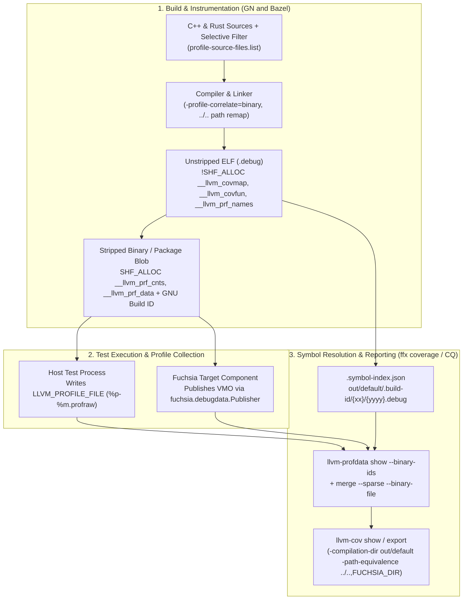
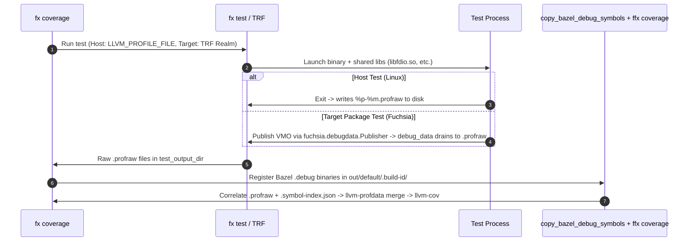

# Fuchsia Test Coverage Architecture (GN & Bazel, Host & Target)

This directory (`//build/config/profile/`) is the primary configuration hub for Fuchsia source-based code coverage across **GN** and **Bazel**, covering both **Host (`host_test`)** and **Target/Device (`fx_test` / `fuchsia_test_package`)** workflows for **C++ and Rust**.

---

## 1. End-to-End Coverage Pipeline Overview

Fuchsia uses LLVM Source-Based Code Coverage (`-fprofile-instr-generate -fcoverage-mapping` for C/C++ and `-Cinstrument-coverage` for Rust) with **binary profile correlation (`-profile-correlate=binary`)**.

Three invariants govern the pipeline across both GN and Bazel:
1. **Non-Allocated Coverage Metadata (`-profile-correlate=binary`)**: Coverage mapping and function/counter names (`__llvm_covmap`, `__llvm_covfun`, `__llvm_prf_names`) are emitted as non-allocated (`!SHF_ALLOC`) ELF sections and stripped out of packaged device blobs, while only runtime counters (`__llvm_prf_cnts`, `__llvm_prf_data`) remain allocated (`SHF_ALLOC`) in memory.
2. **Fail-Fast `.build-id` Symbol Resolution**: Because stripped runtime binaries omit coverage metadata, [`ffx coverage`](../../../src/developer/ffx/plugins/coverage/src/lib.rs) extracts the 20-byte `NT_GNU_BUILD_ID` from every `.profraw` profile (`llvm-profdata show --binary-ids`) and resolves its unstripped `.debug` ELF via `${FUCHSIA_BUILD_DIR}/.symbol-index.json` (primarily `${FUCHSIA_BUILD_DIR}/.build-id/{xx}/{yyyy}.debug`). If **any** instrumented binary or shared library (`libfdio.so`, `libbackend_fuchsia_globals.so`, etc.) is missing from `.build-id`, `ffx coverage` fails fast and aborts before merging profiles.
3. **Source Path Remapping (`../..` -> `${FUCHSIA_DIR}`)**: [`fx coverage`](../../../tools/devshell/contrib/coverage) invokes `llvm-cov` with `-compilation-dir out/default -path-equivalence ../..,${FUCHSIA_DIR}`. Therefore, source paths recorded inside `__llvm_covmap` must be relative to `out/default` (`../../src/...`). GN compiles from `out/default` natively; Bazel compiles from `execroot/_main` and remaps paths via `-fcoverage-prefix-map==../../` (C++) and `--remap-path-prefix=.=../..` (Rust).

---

## 2. GN vs. Bazel Coverage Definitions & Support Matrix

| Layer / Capability | GN Definitions (Host & Target) | Bazel Definitions (Host & Target) |
| :--- | :--- | :--- |
| **Activation & Variant Plumbing** | [`build/config/BUILDCONFIG.gn`](../BUILDCONFIG.gn) (`known_variants` & `select_variant_shortcuts`): - **Host:** `--variant host_coverage`, `host_coverage-rust` -> `host_x64-coverage` toolchain. - **Target:** `--variant coverage`, `coverage-rust`, `coverage-cts` -> `x64-coverage` toolchain. | [`build/bazel/config/BUILD.gn`](../../bazel/config/BUILD.gn) + [`build/bazel/config/bazel_args.gni`](../../bazel/config/bazel_args.gni) emit `bazel_args/{host,fuchsia}.json` (consumed by [`workspace_utils.py`](../../bazel/scripts/workspace_utils.py)): - **C++ (`_build_args`):** `--features=coverage` in `@fuchsia_build_info//:platforms_flags.bzl` -> [`build/bazel/platforms/BUILD.bazel`](../../bazel/platforms/BUILD.bazel). - **Rust (`_common_args`):** `--config=host_rust_coverage` in [`build/bazel/templates/template.bazelrc`](../../bazel/templates/template.bazelrc) (*target Rust config planned*). |
| **C/C++ Compiler & Linker Flags** | `_coverage_c_family_flags` & `variant("coverage")` in [`BUILD.gn`](./BUILD.gn) + `config("optimize_coverage")` in [`build/config/BUILD.gn`](../BUILD.gn): - **Shared:** `-O1`, `-fprofile-instr-generate`, `-fcoverage-mapping`, `-fprofile-list=...`, `-mllvm -profile-correlate=binary` - **Host (`is_linux`):** `-mllvm -runtime-counter-relocation` - **Target (`is_fuchsia`):** `-mllvm -system-headers-coverage`, `-Wl,-dynamic-linker=${libprefix}ld.so.1`, `//src/zircon/lib/zircon` | `coverage_feature` in [`toolchain_utils.bzl`](../../bazel_sdk/bazel_rules_fuchsia/common/toolchains/clang/toolchain_utils.bzl) (instantiated in [`build/bazel/toolchains/clang/toolchains.bzl`](../../bazel/toolchains/clang/toolchains.bzl)): - **Shared:** `-O1`, `-fprofile-instr-generate`, `-fcoverage-mapping`, `-fcoverage-prefix-map==../../`, `-mllvm -profile-correlate=binary` (*`-fprofile-list` planned*) - **Host (`is_linux`):** `-mllvm -runtime-counter-relocation` - **Target (`is_fuchsia`):** `-mllvm -system-headers-coverage`, `-lzircon` |
| **Rust Compiler & Linker Flags** | `variant("coverage-rust")` & `variant("coverage")` in [`BUILD.gn`](./BUILD.gn) + `config("optimize_coverage")` in [`build/config/BUILD.gn`](../BUILD.gn): - **Shared:** `-Copt-level=1`, `-Cinstrument-coverage`, `-Cllvm-args=-profile-correlate=binary` - **Host (`is_linux`):** `-Cllvm-args=-runtime-counter-relocation` - **Target (`is_fuchsia`):** [`llvm_profile_counter_bias.ld`](./llvm_profile_counter_bias.ld), `//src/zircon/lib/zircon`, `:variant-libprefix` | [`build/bazel/templates/template.bazelrc`](../../bazel/templates/template.bazelrc) + Rust toolchains in [`build/bazel/toolchains/rust/rust.BUILD.bazel`](../../bazel/toolchains/rust/rust.BUILD.bazel): - **Host (`build:host_rust_coverage`):** `-Cinstrument-coverage`, `-Cllvm-args=-profile-correlate=binary`, `--remap-path-prefix=.=../..`, `-Cllvm-args=-runtime-counter-relocation` - **Target (*planned*):** `-Cinstrument-coverage`, `-Cllvm-args=-profile-correlate=binary`, `--remap-path-prefix=.=../..`, `-Clink-arg=-lzircon`, plus [`llvm_profile_counter_bias.ld`](./llvm_profile_counter_bias.ld) in `rust_stdlib_filegroup` ([`rust.BUILD.bazel`](../../bazel/toolchains/rust/rust.BUILD.bazel)) |
| **Selective Filter (`profile_source_files`)** | Declared in [`config.gni`](./config.gni); evaluated in [`BUILD.gn`](./BUILD.gn): - Writes `$root_out_dir/profile-source-files.list` for Clang `-fprofile-list` (plus [`profile-cts.list`](./profile-cts.list) on `coverage-cts`). - Gates C++ on `_has_c_files` and Rust on `_has_rust_files`. | *Planned:* - Compute `_has_c_files` & `_has_rust_files` in [`build/bazel/config/bazel_args.gni`](../../bazel/config/bazel_args.gni). - Generate workspace-rebased profile list in [`build/bazel/BUILD.gn`](../../bazel/BUILD.gn) -> `@fuchsia_build_info` ([`workspace_utils.py`](../../bazel/scripts/workspace_utils.py)) and wire into `coverage_feature` & `compiler_files` in [`toolchain_utils.bzl`](../../bazel_sdk/bazel_rules_fuchsia/common/toolchains/clang/toolchain_utils.bzl). |
| **Per-Target Opt-Out** | `config("no-coverage")` (`-fno-profile-instr-generate -fno-coverage-mapping`) in [`BUILD.gn`](./BUILD.gn). | `features = ["-coverage"]` on `cc_*` targets, or `disable_instrumentation = True` in [`build/bazel/rules/cc/fx_cc_binary.bzl`](../../bazel/rules/cc/fx_cc_binary.bzl) (`"coverage"` in `_INSTRUMENTATION_FEATURES`, synced with [`sanitizer.bzl`](../../bazel_sdk/bazel_rules_fuchsia/common/toolchains/clang/sanitizer.bzl)). |
| **Shared Libraries & `PT_INTERP`** | - **Host:** Static `libc++` / `libunwind`. - **Target:** `libprefix = "${variant}/"` in [`build/config/BUILDCONFIG.gn`](../BUILDCONFIG.gn) & `:variant-libprefix` in [`BUILD.gn`](./BUILD.gn) (`PT_INTERP = coverage/ld.so.1`, DSOs in `/pkg/lib/${libprefix}`). | - **Host:** `static_cpp_standard_library_feature` in [`toolchain_utils.bzl`](../../bazel_sdk/bazel_rules_fuchsia/common/toolchains/clang/toolchain_utils.bzl). - **Target:** Installed in `/pkg/lib/` (`PT_INTERP = ld.so.1`; *moving to `/pkg/lib/coverage/` with `PT_INTERP = coverage/ld.so.1` planned*) via [`fx_packaged_binary.bzl`](../../bazel/rules/packages/fx_packaged_binary.bzl) and [`clang_package_resources.bzl`](../../bazel_sdk/fuchsia_rules_common/packages/clang_package_resources.bzl); in-tree IDK shared libs ([`idk_cc_prebuilt_library.bzl`](../../bazel/rules/idk/private/idk_cc_prebuilt_library.bzl), e.g. [`sdk/lib/fdio/BUILD.bazel`](../../../sdk/lib/fdio/BUILD.bazel), [`sdk/lib/syslog/cpp/BUILD.bazel`](../../../sdk/lib/syslog/cpp/BUILD.bazel)) compiled from source. |
| **Component Manifest `DebugData` Routing** | `cm()` in [`tools/cmc/build/cml.gni`](../../../tools/cmc/build/cml.gni) runs `cmc merge` to inject [`sdk/lib/sys/testing/coverage.shard.cml`](../../../sdk/lib/sys/testing/coverage.shard.cml) (`from: "debug"` when `is_coverage`) or [`instrumentation_data.cml`](./instrumentation_data.cml) (`from: "parent/diagnostics"` when `is_profile`) for `fuchsia.debugdata.Publisher`. | `fx_component_manifest` in [`build/bazel/rules/components/fx_component.bzl`](../../bazel/rules/components/fx_component.bzl) runs `cmc merge` to inject [`sdk/lib/sys/testing/coverage.shard.cml`](../../../sdk/lib/sys/testing/coverage.shard.cml) (`//build/bazel/config/variables:is_coverage`) or [`instrumentation_data.cml`](./instrumentation_data.cml) (`//build/bazel/config/variables:is_profile`). |
| **Debug Symbol Registration (Local & CQ)** | Populated into `out/default/.build-id/` during Ninja link; exported via `//:debug_symbols` in [`BUILD.gn`](../../../BUILD.gn). | - **Host:** [`FuchsiaHostTestInfo.cquery`](../../bazel/starlark/FuchsiaHostTestInfo.cquery) + [`bazel_tests_utils.py`](../../bazel/scripts/bazel_tests_utils.py) -> `bazel_host_tests.debug_symbols.json` (copied locally by [`copy_bazel_debug_symbols.py`](../../bazel/scripts/copy_bazel_debug_symbols.py); exempted in CQ by [`build/api/build_api_filter.py`](../../api/build_api_filter.py)). - **Target:** CQ uses `//build/bazel/target_tests:target_tests` & `:debug_symbols` in [`build/bazel/target_tests/BUILD.gn`](../../bazel/target_tests/BUILD.gn) + `//build/toolchain/runtime:` exemption in [`build_api_filter.py`](../../api/build_api_filter.py). Local `fx coverage` (*planned*) materializes `.build-id` in [`build/bazel/rules/testing/fx_test.bzl`](../../bazel/rules/testing/fx_test.bzl) and registers via [`copy_bazel_debug_symbols.py`](../../bazel/scripts/copy_bazel_debug_symbols.py). |

---

## 3. Core Architectural Contrasts: GN vs. Bazel

### 3.1 Multi-Toolchain Variants (GN) vs. Platform & `.bazelrc` Flags (Bazel)
* **GN (`select_variant`)**: [`build/config/BUILDCONFIG.gn`](../BUILDCONFIG.gn) creates separate variant toolchains (`x64-coverage`, `host_x64-coverage`). Note that `--variant coverage` only instruments Fuchsia target toolchains (`host = false`), while `--variant host_coverage` only instruments host toolchains (`host = true`); enabling both in one build directory requires passing both flags.
* **Bazel (`bazel_args.gni` Two-Channel Plumbing)**: Bazel builds all Fuchsia target rules under a single `--config=fuchsia_platform` configuration. During `fx gen`, [`build/bazel/config/bazel_args.gni`](../../bazel/config/bazel_args.gni) inspects GN's `fuchsia_toolchain_tags` and `host_toolchain_tags` and writes `$root_build_dir/bazel_args/{fuchsia,host}.json` across two channels consumed by [`workspace_utils.py`](../../bazel/scripts/workspace_utils.py):
  1. **`_build_args` -> `@fuchsia_build_info//:platforms_flags.bzl`**: Attaches `--features=coverage` directly to the host (`linux_*`) or target (`fuchsia_platform_*`, `fuchsia_sdk_*`) `platform(flags = ...)` definitions in [`build/bazel/platforms/BUILD.bazel`](../../bazel/platforms/BUILD.bazel). Because `platform(flags = ...)` is automatically scoped to the matching platform across transitions and evaluated by both `bazel cquery` (`fx gen`) and `bazel build` (`fx build`), it keeps `ST-<hash>` output paths consistent.
  2. **`_common_args` -> `workspace/.bazelrc`**: Appends `.bazelrc` `--config` flags (such as `--config=host_rust_coverage`, defined in [`build/bazel/templates/template.bazelrc`](../../bazel/templates/template.bazelrc)) for `--@rules_rust//rust/settings:extra_rustc_flags`.

### 3.2 Selective Instrumentation (`profile_source_files`)
* **Full CQ (`fuchsia-coverage-absolute`) vs. Incremental CQ (`fuchsia-coverage`)**: [`config.gni`](./config.gni) defaults `profile_source_files = ["//*"]` (full tree) and `dont_profile_source_files = ["//prebuilt/*"]`. On incremental CQ, infra overrides `profile_source_files` with the list of files modified by the CL.
* **Per-Language Gating (`_has_c_files` & `_has_rust_files`)**: [`BUILD.gn`](./BUILD.gn) checks whether `profile_source_files` contains any C/C++ files or `.rs` files. Because `rustc` has no equivalent to Clang's `-fprofile-list`, Rust selective coverage operates at the crate/config level: if a CL only modifies C++ files, `_has_rust_files` is `false` and Rust coverage flags are skipped altogether (and vice versa).
* **`-fprofile-list` Working-Directory Path Rebasing**: Clang matches `source:<glob>` patterns in `-fprofile-list` against the source path passed on the compile command line. Because GN compiles from `out/default` (`../../src/...`) whereas Bazel compiles from `execroot/_main` (`src/...`), GN and Bazel require differently rooted `-fprofile-list` files.

### 3.3 Fuchsia Target Specifics: `llvm_profile_counter_bias.ld` & Shared Libraries (`/pkg/lib/`)
* **Why Target Rust Uses `llvm_profile_counter_bias.ld`**: On Linux (`is_linux`), both Clang and `rustc` use `-runtime-counter-relocation`. On Fuchsia (`is_fuchsia`), Clang does not use `-runtime-counter-relocation`, but `rustc -Cinstrument-coverage` still emits an undefined symbol reference to `__llvm_profile_counter_bias`. Fuchsia target Rust links [`llvm_profile_counter_bias.ld`](./llvm_profile_counter_bias.ld) (`PROVIDE_HIDDEN(__llvm_profile_counter_bias = 0);`) plus `-lzircon` to satisfy the profiling runtime.
* **Why Bazel Currently Uses `/pkg/lib/` (`PT_INTERP = ld.so.1`) Before `/pkg/lib/coverage/`**:
  * In GN, a single package can mix uninstrumented and variant-instrumented binaries, so GN sets `PT_INTERP = coverage/ld.so.1` and packages variant shared libraries under `/pkg/lib/coverage/`.
  * In Bazel today, only `asan`/`hwasan` use variant subdirectories. Single-variant target builds install `ld.so.1`, `libc++.so.2`, `libstd-*.so`, and source-built IDK shared libraries ([`sdk/lib/fdio/BUILD.bazel`](../../../sdk/lib/fdio/BUILD.bazel), [`sdk/lib/syslog/cpp/BUILD.bazel`](../../../sdk/lib/syslog/cpp/BUILD.bazel), [`sdk/lib/async-default/BUILD.bazel`](../../../sdk/lib/async-default/BUILD.bazel)) into `/pkg/lib/` with `PT_INTERP = ld.so.1`. When `--features=coverage` is enabled on the target platform, those in-tree IDK `cc_shared_library` targets are compiled and linked from source with coverage instrumentation, packaged into `/pkg/lib/`, and stripped into `<pkg>_fuchsia_package.elf_binaries/.build-id/`. Packaging under `/pkg/lib/coverage/` (`PT_INTERP = coverage/ld.so.1`) is planned to support mixed-variant packages and Incremental CQ.

---

## 4. Runtime Collection & Debug Symbol Resolution (Host vs. Target)

* **Host Runtime Collection**: `fx test` (or infra `testrunner`) sets `LLVM_PROFILE_FILE=${test_output_dir}/%p-%m.profraw`, and the test process writes raw profiles directly to disk on exit.
* **Target Runtime Collection (VMO + TRF)**: On Fuchsia, `libclang_rt.profile.a` creates a VMO for the executable and each instrumented shared library and publishes them at startup via `/svc/fuchsia.debugdata.Publisher`. Component manifest compilation ([`tools/cmc/build/cml.gni`](../../../tools/cmc/build/cml.gni) in GN and [`fx_component.bzl`](../../bazel/rules/components/fx_component.bzl) in Bazel) injects [`coverage.shard.cml`](../../../sdk/lib/sys/testing/coverage.shard.cml) (`from: "debug"`) or [`instrumentation_data.cml`](./instrumentation_data.cml) (`from: "parent/diagnostics"`) so the component declares `use` for `fuchsia.debugdata.Publisher`. The Test Runner Framework (`elf_test_runner`, `gtest_runner`, `rust_test_runner`) routes `fuchsia.debugdata.Publisher` to `debug_data`, which drains the VMOs into `.profraw` host artifacts on test teardown.
* **Debug Symbol Registration (Local vs. CQ)**:
  * **Local `fx coverage`**: Runs [`copy_bazel_debug_symbols.py`](../../bazel/scripts/copy_bazel_debug_symbols.py) after `fx test` to populate built Bazel `.debug` binaries into `${FUCHSIA_BUILD_DIR}/.build-id/` before invoking [`ffx coverage`](../../../src/developer/ffx/plugins/coverage/src/lib.rs). Prebuilt toolchain `.build-id` directories ([`build/bazel/toolchains/clang/BUILD.bazel`](../../bazel/toolchains/clang/BUILD.bazel), [`build/bazel/toolchains/rust/BUILD.bazel`](../../bazel/toolchains/rust/BUILD.bazel)) are already registered in `.symbol-index.json`, and `ld.so.1` (`libc.so`) is populated by Ninja's `sysroot_for_fuchsia_platform`.
  * **CQ (`fuchsia-coverage-absolute` / `fuchsia-coverage`)**: `//build/bazel/target_tests:target_tests` (`copy_debug_symbols = true`) and `//build/bazel/target_tests:debug_symbols` in [`build/bazel/target_tests/BUILD.gn`](../../bazel/target_tests/BUILD.gn) ([`generate_package_debug_symbols_manifest.py`](../../packages/generate_package_debug_symbols_manifest.py)) export target test `.debug` manifests to `//:debug_symbols`, while [`build/api/build_api_filter.py`](../../api/build_api_filter.py) exempts `bazel_host_tests.debug_symbols.json` and `//build/toolchain/runtime:` so `export_last_build_debug_symbols` uploads all required `.debug` binaries.

---

## 5. Key Files Index

* **GN Coverage & Variants**: [`build/config/BUILDCONFIG.gn`](../BUILDCONFIG.gn), [`build/config/BUILD.gn`](../BUILD.gn), [`build/config/profile/BUILD.gn`](./BUILD.gn), [`build/config/profile/BUILD.bazel`](./BUILD.bazel), [`build/config/profile/config.gni`](./config.gni), [`build/config/profile/instrumentation_data.cml`](./instrumentation_data.cml), [`build/config/profile/llvm_profile_counter_bias.ld`](./llvm_profile_counter_bias.ld), [`build/config/profile/profile-cts.list`](./profile-cts.list), [`sdk/lib/c/sysroot_entries.gni`](../../../sdk/lib/c/sysroot_entries.gni), [`sdk/lib/sys/testing/coverage.shard.cml`](../../../sdk/lib/sys/testing/coverage.shard.cml), [`tools/cmc/build/cml.gni`](../../../tools/cmc/build/cml.gni)
* **GN-to-Bazel Plumbing**: [`build/bazel/BUILD.gn`](../../bazel/BUILD.gn), [`build/bazel/config/BUILD.gn`](../../bazel/config/BUILD.gn), [`build/bazel/config/bazel_args.gni`](../../bazel/config/bazel_args.gni), [`build/bazel/config/variables/BUILD.bazel`](../../bazel/config/variables/BUILD.bazel), [`build/bazel/platforms/BUILD.bazel`](../../bazel/platforms/BUILD.bazel), [`build/bazel/templates/template.bazelrc`](../../bazel/templates/template.bazelrc), [`build/bazel/scripts/workspace_utils.py`](../../bazel/scripts/workspace_utils.py)
* **Bazel Toolchains**: [`build/bazel_sdk/bazel_rules_fuchsia/common/toolchains/clang/toolchain_utils.bzl`](../../bazel_sdk/bazel_rules_fuchsia/common/toolchains/clang/toolchain_utils.bzl), [`build/bazel_sdk/bazel_rules_fuchsia/common/toolchains/clang/sanitizer.bzl`](../../bazel_sdk/bazel_rules_fuchsia/common/toolchains/clang/sanitizer.bzl), [`build/bazel/toolchains/clang/toolchains.bzl`](../../bazel/toolchains/clang/toolchains.bzl), [`build/bazel/toolchains/clang/BUILD.bazel`](../../bazel/toolchains/clang/BUILD.bazel), [`build/bazel/toolchains/rust/rust.BUILD.bazel`](../../bazel/toolchains/rust/rust.BUILD.bazel), [`build/bazel/toolchains/rust/BUILD.bazel`](../../bazel/toolchains/rust/BUILD.bazel)
* **Bazel Packaging & Shared Libraries**: [`build/bazel/rules/cc/fx_cc_binary.bzl`](../../bazel/rules/cc/fx_cc_binary.bzl), [`build/bazel/rules/components/fx_component.bzl`](../../bazel/rules/components/fx_component.bzl), [`build/bazel/rules/testing/fx_test.bzl`](../../bazel/rules/testing/fx_test.bzl), [`build/bazel/rules/packages/fx_package.bzl`](../../bazel/rules/packages/fx_package.bzl), [`build/bazel/rules/packages/fx_packaged_binary.bzl`](../../bazel/rules/packages/fx_packaged_binary.bzl), [`build/bazel/rules/idk/private/idk_cc_prebuilt_library.bzl`](../../bazel/rules/idk/private/idk_cc_prebuilt_library.bzl), [`build/bazel_sdk/fuchsia_rules_common/debug_symbols/debug_symbols.bzl`](../../bazel_sdk/fuchsia_rules_common/debug_symbols/debug_symbols.bzl)
* **Debug Symbols & `fx coverage`**: [`tools/devshell/contrib/coverage`](../../../tools/devshell/contrib/coverage), [`src/developer/ffx/plugins/coverage/src/lib.rs`](../../../src/developer/ffx/plugins/coverage/src/lib.rs), [`build/bazel/scripts/copy_bazel_debug_symbols.py`](../../bazel/scripts/copy_bazel_debug_symbols.py), [`build/bazel/scripts/bazel_tests_utils.py`](../../bazel/scripts/bazel_tests_utils.py), [`build/bazel/target_tests/BUILD.gn`](../../bazel/target_tests/BUILD.gn), [`build/packages/generate_package_debug_symbols_manifest.py`](../../packages/generate_package_debug_symbols_manifest.py), [`build/api/build_api_filter.py`](../../api/build_api_filter.py)
