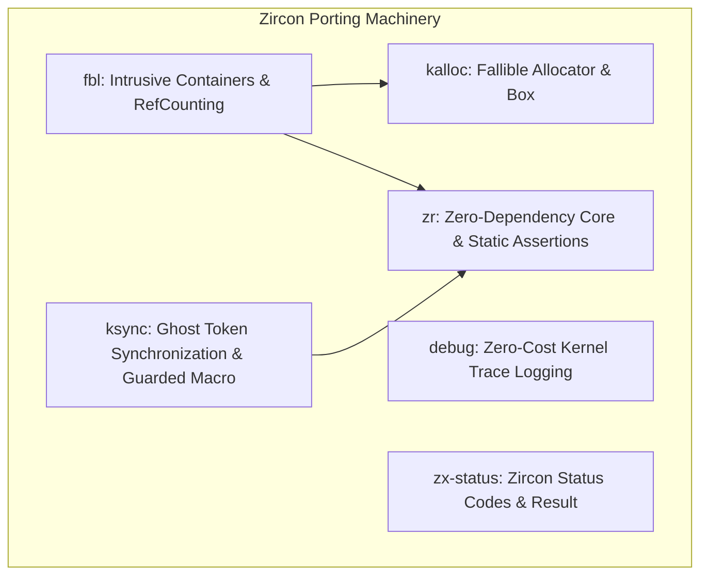

# Zircon C++ to Rust Porting Rubric & Guidelines

This skill documents the unified rubric, patterns, safety rules, and evaluation
criteria for porting Zircon kernel and library code from C++ to Rust, as well as
reviewing converted code.

It serves as the single source of truth for both **Coder agents** implementing
the port and **Reviewer agents** evaluating the port.

---

## 1. Core Principles

1.  **Direct Translation, Control-Flow Fidelity, & API Parity**: Translate C++
    code to Rust using equivalent data structures, algorithms, and control flow.
    The Rust API must expose all public functions, methods, constructors, and
    configurations present in the C++ version, and function bodies should
    preserve the structure and check ordering of the C++ original rather than
    restructuring control flow or inventing local helper types without cause.
    When C++ calls a specific method or overload on a collaborating object, call
    the corresponding method on the Rust type (adding it if missing) rather than
    re-implementing its logic inline at the call site.
2.  **Exact Memory Layout & Alignment Parity**: Rust structs shared across FFI
    or replacing C++ objects must match the memory layout, alignment, and size
    of corresponding C++ objects exactly. Verify with compile-time static
    assertions (`zr::static_assert!`).
3.  **Test & Fuzz Parity**: Rust test and fuzz coverage must equal C++ coverage.
    Match every C++ unit test case with a Rust test case. If C++ code has fuzz
    tests, implement equivalent Rust fuzzers (`rustc_fuzzer` + `arbitrary`). Add
    a test with no C++ counterpart only when it covers behavior nothing else
    tests, and say what it covers in the CL description; tests that re-check
    language or library behavior, or that duplicate core tests, are noise.
    Kernel unit tests must be hermetic: they must not change global or per-CPU
    kernel state.
4.  **Fallible Allocation**: All allocations in kernel mode (`is_kernel`) must
    be explicit and fallible via `kalloc::Box`. Panics on Out-Of-Memory (OOM)
    are strictly unacceptable in kernel code.
5.  **Token-Based Concurrency & Locking Parity**: Locking strategies and
    concurrency protocols must match C++ code and integrate with Zircon's
    token-based synchronization framework (`ksync`).
6.  **Pointer Safety & Strict Provenance**: Prefer `NonNull<T>` and
    `Option<NonNull<T>>` over raw pointers (`*const T`/`*mut T`). Use
    `core::ptr::with_exposed_provenance` when converting integer addresses back
    to pointers.
7.  **Documentation & Comment Parity**: Port architectural notes, safety
    rationale, doc comments, and inline implementation comments. Clearly
    distinguish between outer documentation and inner inline comments:
    * **Outer documentation**: All public traits, structs, enums, methods, and
      functions (except for `#[syscall]` definitions) MUST have Rustdoc (`///`)
      comments. `unsafe` functions must include a `# Safety` section, and all
      `unsafe` blocks must have `// SAFETY:` explanations.
    * **Inner inline comments**: All inline comments (`// ...`) within C++
      source and header files (`.cc` and `.h`) documenting behavior MUST be
      preserved in the corresponding Rust code, updating identifiers that have
      changed names to make sense in Rust.
8.  **Ergonomic Design & DRY**: Apply idiomatic Rust practices (derive macros,
    `Deref`/`DerefMut`, `Default`, `Option`/`Result`, `?` operator, returning
    values via `Option<T>` or `Result<T, Status>` instead of C-style
    out-parameters) without breaking layout or safety requirements. Keep
    visibility as tight as possible (`pub(crate)` or file-private). Preserve
    named constants. Apply idioms within the C++ structure: keep function
    boundaries, helpers and control-flow shape so the port can be compared side
    by side. Do not inline helpers, merge or split functions, or unroll macros
    unless the C++ shape cannot be expressed in Rust.
9.  **Cross-Language FFI Interoperability**: FFI shims must be minimal and
    declarative 1:1 forwards with zero business logic, branching, or sub-object
    chaining. Facade methods for unported C++ classes must correspond 1:1 to
    actual methods on the C++ class. C++ helper functions exposed to Rust must
    be prefixed with `cpp_` and declared in C++ header files. Rust functions
    exposed to C++ must be prefixed with `rust_`.
10.  **Allocation Tier & Stack Parity**: Respect the original C++ memory
     placement (heap, static, intrusive, or stack). Because kernel thread stacks
     are constrained, do not shift heap or static storage onto the stack.
     Intermediate working buffers must maintain the C++ allocation tier, with
     stack allocation reserved only for small scalar or primitive helpers.

---

## 2. The Zircon Rust Porting Machinery

Fuchsia provides custom in-tree crates designed for low-level kernel and library
porting:



* **`zr`**: Fundamental zero-dependency building blocks (`zr::static_assert!`,
  `zr::defer`, `zr::Deferred`, `Opaque<T>`, `OpaqueBytes<N>`, `pin_init_ffi!`).
* **`kalloc`**: Fallible memory allocation (`kalloc::Box`, `Allocator` trait).
* **`ksync`**: Token-based "Ghost Token" synchronization (`KMutex`, `BrwLockPi`,
  `KCell`, `LockToken`, `#[guarded]`).
* **`fbl`**: Intrusive containers (`DoublyLinkedList`, `SinglyLinkedList`,
  `WavlTree`), reference counting (`#[ref_counted]`, `RefPtr`), and FFI
  recycling (`Recyclable`). Non-intrusive containers (`Array`, `InlineArray`,
  `Vector`).
* **`debug`**: Module-level conditional debug tracing (`LOCAL_TRACE`,
  `ltracef!`, `ltrace_entry!`) and `dprintf!`.
* **`zx-status`**: Canonical `zx_status::Status` error types for `Result<T,
  Status>`.

---

## 3. Detailed Guidelines & Technical Patterns

### 3.1. Memory Layout Matching & Verification
- Mark FFI-shared structs with `#[repr(C)]`.
- Do not heap-box (`kalloc::Box`) a ported Rust struct behind an extra pointer
  in the C++ wrapper when the C++ class stored its fields inline; match the
  inline layout in-place instead.
- Always add compile-time static assertions for size and alignment in Rust using
  `zr::static_assert!`. Add matching `static_assert` assertions in C++ test
  files.
- For opaque or non-ported C++ fields, use `zr::Opaque<T>` or
  `zr::OpaqueBytes<SIZE>`.
- To enforce custom alignment on `OpaqueBytes`, wrap it in a newtype struct
  annotated with `#[repr(C, align(N))]`.

```rust
#[repr(C, align(8))]
pub struct CppStateStorage(pub zr::OpaqueBytes<64>);

#[repr(C)]
pub struct PortedStruct {
    pub cpp_state: CppStateStorage,
    pub rust_val: u32,
}

zr::static_assert!(core::mem::size_of::<PortedStruct>() == 72);
zr::static_assert!(core::mem::align_of::<PortedStruct>() == 8);
```

### 3.2. Fallible Allocation (`kalloc`)
- Kernel code must **never** use standard `alloc::boxed::Box` or collections
  that panic on OOM.
- Use `kalloc::Box::try_new(val)` for single values.
- Use `kalloc::Box::<[T]>::try_new_zeroed_slice(len)` for slices of `FromZeros`
  types; the slice it returns is already initialized. Otherwise use
  `try_new_uninit_slice(len)` and `assume_init()` once every element is written.
- Use `try_grow(&mut slice, new_len)` and `unsafe { try_shrink(&mut slice,
  new_len) }` for resizing slices.
- Allocation fails with `kalloc::AllocError`; map it to `Status::NO_MEMORY`.

```rust
let my_box = kalloc::Box::try_new(42u32).map_err(|_| Status::NO_MEMORY)?;
let slice =
    kalloc::Box::<[u32]>::try_new_zeroed_slice(10).map_err(|_| Status::NO_MEMORY)?;
```

### 3.3. Pointer Safety, `NonNull`, & Strict Provenance
- Avoid raw pointers (`*const T` or `*mut T`) in public or internal Rust APIs.
- Use `NonNull<T>` for pointers that must never be null.
- Use `Option<NonNull<T>>` for optional pointers (takes advantage of Null
  Pointer Optimization so size equals a raw pointer).
- Avoid `Cell` for interior mutability of pointers if the object must be `Sync`.
  Instead, accept `NonNull<T>` and take `&mut self` on setter methods.
- Strict Provenance: When converting `usize` addresses (e.g. from VMAR mappings)
  back to pointers, use `core::ptr::with_exposed_provenance::<T>(addr)` or
  `with_exposed_provenance_mut` instead of raw `as *const T` / `as *mut T`
  casts.

```rust
/// A read-only view of mapped memory.
pub struct Mapping {
    /// Address of `size` bytes that stay mapped, and are not written, for as
    /// long as this `Mapping` exists. Zero if nothing is mapped.
    base: usize,
    size: usize,
}

impl Mapping {
    /// Returns the mapped bytes.
    pub fn as_slice(&self) -> &[u8] {
        if self.base == 0 {
            &[]
        } else {
            // SAFETY: `base` addresses `size` mapped bytes that nothing writes
            // while `self` is alive, and the slice borrows `self`.
            unsafe {
                let ptr = core::ptr::with_exposed_provenance::<u8>(self.base);
                core::slice::from_raw_parts(ptr, self.size)
            }
        }
    }
}
```

### 3.4. Token-Based Concurrency (`ksync`)
- Concurrency in Zircon separates lock state (`KMutex`, `BrwLockPi`) from data
  (`KCell<T, Class>`). Accessing data requires proving lock ownership via
  `LockToken<'a, Class>`.
- Use the `#[guarded]` procedural macro on structs containing locks and guarded
  data.
- The `#[guarded]` macro autogenerates a unique Lock Class (Zero-Sized Type).
  **Do not** add a generic `Class: LockClass` parameter to the parent struct
  unless explicitly required by callers.
- Stack-pin the structure and use `ksync::lock!` to acquire lock guards.
- For disjoint mutable borrows of multiple guarded fields, use generated
  projection helper methods (`fields()`, `fields_mut()`).
- Custom Raw Locks: If custom locking primitives (`RawLock`) are used, always
  define and use a lightweight RAII `LockGuard` helper so early returns (`?`)
  automatically unlock.
- Locks support different policies when acquiring, this is most notable of
  spinlocks that can save or not save IRQs when acquired. Ensure that the
  correctly matching policy is used in the Rust lock acquisition as the C++.
- **Lock Parity Audit**: Count lock acquisitions and thread-safety annotations
  (`Guard<`, `TA_REQ`, `TA_GUARDED`, `TA_EXCL`) in the C++ and their
  counterparts in the port. A dropped lock compiles and usually boots.
- Acquire each lock before any read the C++ performs under it, and do not add
  locks the C++ does not have.
- Preserve lockdep options (`CallUntracked`, lock flags) and give each Rust lock
  the same lock class as its C++ counterpart.
- Translate a C++ `TA_REQ(lock)` on a function into a `LockToken` parameter, or
  into a safety obligation, documented under `# Safety`, that names the lock.
- Inline `asm!` must not use `options(nomem)` or `options(readonly)` where the
  C++ uses `asm volatile` with a memory clobber; those options let the compiler
  reorder memory accesses around the instruction.
- Temporarily Releasing Locks (`call_unlocked`): Translate C++
  `Guard::CallUnlocked` directly to `guard.as_mut().call_unlocked(|| { ... })`
  rather than splitting a single lock guard scope into separate `{
  ksync::lock!(...); }` blocks.

```rust
#[guarded]
pub struct NetworkDevice {
    #[mutex]
    mu: KMutex,

    #[guarded_by(mu)]
    pub tx_packets: u64,
    #[guarded_by(mu)]
    pub rx_packets: u64,
}

// Accessing guarded fields:
ksync::lock!(let mut guard = dev.lock_mu());
let fields = guard.as_mut().fields_mut();
*fields.tx_packets += 1;
*fields.rx_packets += 1;
```

### 3.5. Intrusive Containers & Reference Counting (`fbl`)
- Ref-Counted Objects: Annotate structs with `#[fbl::ref_counted]` (requires
  `#[repr(C)]`). This injects `ref_count` at offset 0. Use `fbl::RefPtr<T>` and
  `fbl::make_ref_counted!`.
- Cross-Language Lifecycles: Implement `Recyclable` (or
  `#[derive(Recyclable)]`). Provide an FFI callback (e.g. `rust_recycle_<type>`)
  on C++ side that invokes `Recyclable::recycle_ffi`.
- Unported C++ `fbl::RefCounted` Types (`Opaque<bindings::T>` vs
  `fbl::impl_opaque_ref_counted_facade!`):
  - **Bindgen-Backed Types** (e.g., `VmObject`, `VmCowPages`, `PageSource`):
    When `bindgen` generates a struct (`bindings::T`) for a C++
    `fbl::RefCounted` type, **do NOT use
    `fbl::impl_opaque_ref_counted_facade!`**. That macro replaces the struct
    body with a zero-sized `OpaqueRefCountedFacade<T>`, losing the true C++
    size/alignment (`size_of::<T>() == 0`) and creating a pointer-type mismatch
    between `*mut Self` and `*mut bindings::T`. Instead, keep `raw:
    Opaque<bindings::T>` (with `phantom: PhantomData<PhantomPinned>`), define
    `as_raw(&self) -> *mut bindings::T { self.raw.get() }`, and manually
    implement `fbl::HasRefCount` and `fbl::Recyclable` delegating to
    `bindings::cpp_<type>_get_ref_counted(self.as_raw())` and
    `bindings::cpp_<type>_free(ptr.as_ptr().cast())`.
  - **Non-Bindgen (`extern "C"`) Facade Types** (e.g., `VmMapping`,
    `VmAddressRegion`, `Bti`, `Pmt`): Only use
    `fbl::impl_opaque_ref_counted_facade!` when there is no `bindgen`-generated
    struct and hand-written `extern "C"` declarations take `*mut Self` / `&Self`
    directly.
- Intrusive Containers: Derive `DoublyLinkedListContainable`,
  `SinglyLinkedListContainable`, or `WavlTreeContainable`. Annotate node fields
  with `#[dll_node]`, `#[sll_node]`, or `#[wavl_node]`. Use `tag = ...` for
  multiple containers. Always prefer derive macros over manual trait
  implementations.

### 3.6. Safe Initialization in `PinInit`
- When initializing structs via `PinInit` (e.g. `pin_init!`), perform setup on
  `Move` fields *before* moving them into the struct using block expressions.
- Avoid using `unsafe` in `pin_init!` post-initialization blocks (`_: { ... }`)
  to bypass lock/cell wrappers.

```rust
pin_init!(Self {
    mutex <- KMutex::init(),
    bitmap: {
        let mut bitmap = RawBitmapGeneric::default();
        bitmap.reset(MAX_ID)?;
        bitmap
    }.into(),
}? Status)
```

### 3.7. Zircon Status & Error Handling
- Depend on `//sdk/rust/zx-status` (`zx_status::Status`).
- Do **not** re-define `zx_status_t` or `ZX_ERR_*` constants locally.
- Use `Result<T, Status>` as return type for fallible operations and leverage
  `?` for error propagation.
- Keep `Status` at FFI boundaries instead of collapsing it to `i32`.
- Use the kernel's Rust newtypes for times, durations, deadlines, rights and
  clocks instead of bare integers. Kernel durations are signed (`i64`).

### 3.8. Testing & Fuzz Testing Parity
- **Kernel Mode (`zircon/kernel/`) vs Userspace**:
  - Kernel crates do **NOT** run standard `#[test]` / `#[cfg(test)]`. Use kernel
    in-tree `unittest-rs` (`#[cfg(ktest)]` + `#[unittest::suite]`) executed via
    `k ut`, or core integration tests in `zircon/system/utest/core/`.
  - Userspace crates use standard `#[test]` and `#[cfg(test)]` executed via `fx
    test`.
- **Assertion Mapping**: Use `expect_eq!`, `assert_eq!`, `expect_ok!`,
  `assert_ok!`, `expect_true!`, etc. from `unittest`.
- **Build integration**: In GN, add `//zircon/kernel/lib/unittest:unittest-rs`
  to the `test_deps` of the `kernel_rust_mod()` or `kernel_rust_crate()` target
  defining the kernel Rust test sources. Bear in mind that tests need to end up
  in the link and that nothing in the kernel crate directly references these
  symbols; so in the case of the source set that contains the tests only
  contains the tests, one must define them in a `kernel_rust_mod()` target
  instead of `kernel_rust_crate()` to prevent GC.
- **Kernel Test Suite Naming Convention**:
  - When naming kernel Rust test suites using `#[unittest::suite]`:
    1.  Prefer standard idiomatic module names like `mod tests { ... }` or
        descriptive module names (e.g. `mod ksync_tests { ... }`). Do not rename
        `mod tests` to awkward module names just to avoid `name = "..."`.
    2.  Use the default suite name matching the module name (`#[unittest::suite]
        mod <name>`) unless it collides with an existing C++ suite's name or is
        a generic `mod tests`.
    3.  Use `#[unittest::suite(name = "...")]` to explicitly specify the suite
        name for `mod tests` or when disambiguation is required.
    4.  If the suite name collides with an existing C++ suite's name, append
        `_rust` to the name of the suite to disambiguate (e.g. `cbuf_rust`,
        `timer_rust`, `mp_rust`, `user_copy_rust`).
    5.  Do not prefix with `rust_` (e.g. avoid `rust_cbuf`, `rust_timer`,
        `rust_mp`).
- **Fuzz Testing**: If C++ code has fuzz tests, implement equivalent Rust
  fuzzers in a separate crate using `rustc_fuzzer`, `fuzz`, and `arbitrary`. Add
  fuzzer components to `BUILD.gn`.

### 3.9. Local Trace Logging (`ltrace`), `dprintf` and `printf`
- Preserve all C++ `LOCAL_TRACE` / `LTRACE` statements.
- Depend on `//zircon/kernel/lib/debug` and `use debug::ltracef;`.
- Define module-scoped `const LOCAL_TRACE: u32 = 0;` at the top of each file.
- Use `ltracef!`, `ltrace_entry!`, `ltrace_exit!`, `ltrace_entry_obj!`, etc.
  When `LOCAL_TRACE` is `0`, dead-branch elimination eliminates all CPU and
  string footprint in production builds.
- Preserve `dprintf` using the `dprintf!` macro from `//zircon/kernel/lib/debug`
- Use `kprint` and `kprintln!` from `//src/lib/kprint` to replace `printf`.

### 3.10. Code Organization, Control Flow, Ergonomics, & Visibility
- **File Structure Parity**: Organize Rust modules matching C++ header/source
  files. Re-export public types at root level (`pub use`) to preserve flat C++
  header APIs.
- **Control-Flow & Structural Fidelity**: Preserve the control flow, variable
  structure, and sequence of checks within function and method bodies from the
  C++ original (e.g., shared post-branch validation checks or extracting a
  common target reference across `if`/`else if` branches) unless Rust's borrow
  checker or safety rules strictly require restructuring. Do not invent local
  helper enums or duplicate branch checks when the C++ control flow can be
  expressed directly in Rust.
- **Exact Collaborator Method / Overload Parity**: When C++ calls a specific
  method or overload on a collaborating object (for example, a lookup method
  that both validates required preconditions/rights and returns outputs, or a
  lookup method that requires no rights), call the corresponding method on the
  Rust type (adding the missing method or variant to that type if needed) rather
  than calling a lower-level method and re-implementing the check inline at the
  call site.
- **Idiomatic Return Values Instead of Out-Parameters**: When a C++ method or
  function returns `bool` or `zx_status_t` and populates one or more
  out-parameters (`T* out`) by value (where the caller does not need to provide
  pre-allocated backing storage or pinned in-place memory), the Rust method MUST
  return the value directly via `Option<T>`, `Result<T, Status>`, or a tuple
  `Result<(T, U), Status>` rather than taking `&mut T` out-parameters. If C++
  callers still invoke the method via a `rust_*` FFI trampoline, perform the
  out-parameter adaptation inside the FFI trampoline, not on the Rust method
  itself.
- **Tight Visibility**: Keep items private or `pub(crate)`. Functions, types, or
  helpers used only within a single file MUST NOT be marked `pub` or
  `pub(crate)`.
- **Idiomatic Traits**: Implement `Default` for types with natural empty states.
  Use `Deref` / `DerefMut` for slice-like or container-like types. Use
  `zerocopy` (`FromBytes`, `IntoBytes`) for safe byte casting instead of
  `unsafe` pointer casts. Use `num-traits` (`Unsigned`, `Bounded`,
  `FromPrimitive`) for generic numeric types.
- **Generic Const Expressions Workaround**: When porting templates with capacity
  $N$ plus null terminator, let Rust generic parameter $N$ represent total
  backing array size.

### 3.11. Check existing Rust conversions
- Before introducing FFI shims, or copying constants, check if there is already
  a Rust implementation. For any object, function, etc, you should
  1.  Go to the location of the C++ definition.
  2.  Walk up the directory structure to find a Rust module.
  3.  See if there is a similar Rust struct / method impl, taking into account
      common naming differences, e.g. for functions C++ tends to use
      UpperCamelCase where as Rust uses lower_snake_case.
- Before writing a helper, search for an existing one: status conversions
  (`zx_status::Status` methods such as `result_into_raw`), the rights-checking
  handle lookups, `pin_init!`, `kernel_oops!`, `zerocopy`, and `core` methods.
- Never call a `cpp_*` function directly where a Rust facade for that object
  already exists; use the facade.

### 3.12. Copyright Modernization & Preservation
- Keep existing copyright headers and dates if the converted file is not
  meaningfully divergent. Do not automatically modernize the year to the current
  year when porting code that is largely a direct translation or maintains the
  original architecture. Maintain the original copyright authors and dates from
  the C++ file.
- A truly new file with no C++ original starts with `Copyright 2026 The Fuchsia
  Authors`. Code under `zircon/kernel/` uses the MIT-style license header;
  elsewhere, copy the license lines from neighboring files in the same
  directory.

### 3.13. FFI Interoperability & Facade Method Parity
- Minimal Shims: Isolate FFI functions in `*_ffi.cc` / `*_ffi.rs`; they should
  be purely declarative with zero logic.
- Shim Existing APIs: Expose the C++ methods the original code calls. Do not add
  new C++ methods for the port's convenience. Where a shim would only forward to
  a simple C++ free function, giving that function `extern "C"` linkage and
  declaring it in a Rust `unsafe extern "C"` block is an alternative to a
  `cpp_*` shim.
- **Strict 1:1 Parity for Facade Methods & `cpp_*` FFI Shims**:
  - Every method added to a Rust facade for an unported C++ class MUST
    correspond 1:1 to an actual method on that C++ class. Never invent synthetic
    convenience or composite methods on a facade that do not exist on the C++
    class.
  - Every `cpp_*` FFI function (`*_ffi.cc` / `*_ffi.rs`) must be a single direct
    forwarding call to one C++ method or function with zero business logic.
    Never encode branching logic (`if`/`else`) or chain across sub-objects
    (`obj->sub_obj()->Method()`) inside a `cpp_*` FFI function. If C++ accesses
    a sub-object or helper class (`sub_obj()`), define a Rust facade for that
    sub-object type as well and expose each method 1:1.
- Consistent Naming:
  - C++ exported to Rust: `cpp_$namespace_$classname_$functionname`
  - Rust exported to C++: `rust_$modpath_$struct_$functionname`
- Prototype Declarations in C++ Headers: All C++ FFI helper functions defined in
  `.cc` files (`cpp_*`) MUST have prototype declarations in an included C++
  header file enclosed in `extern "C"` blocks.
- Prefer References in FFI Trampolines: FFI trampolines callable from C++ that
  receive non-null pointers to initialized objects should prefer taking
  `&<Type>` or `&mut <State>` directly in Rust signatures rather than raw
  pointers (`*const`/`*mut`).
- Always-Inline Annotations for Short FFI Routines: Definitions for short C++
  FFI helper routines provided to Rust callers (`cpp_*`, e.g. trivial forwarding
  shims or accessors) should include `<kernel/ffi.h>`, use the
  `FFI_ALWAYS_INLINE` macro, and include a TODO tied to
  `https://fxbug.dev/537458631` (e.g., `// TODO(https://fxbug.dev/537458631):
  Remove the annotations once cross-language inlining works.`). Only apply this
  to `cpp_*` routines called by Rust; never apply it to C++ class methods or
  routines calling Rust (`rust_*`).
- Uninitialized Storage in FFI Initializers: When passing uninitialized storage
  (e.g., from Rust `core::mem::MaybeUninit<T>`) to a C++ FFI routine to
  construct an object, the C++ function should include `<kernel/ffi.h>` and take
  `ffi::Uninitialized<T>*` instead of raw `T*`. Initialize the object in C++ via
  `handle_out->Initialize(...)`.

### 3.14. RAII Deferred Cleanup (`zr::defer`)
- **Translating `fit::defer`**: Translate C++ `fit::defer` /
  `fit::deferred_action` cleanup patterns into `zr::defer` / `zr::Deferred`.
- **Automatic Error Cleanup**: `zr::defer` executes a closure upon being
  dropped, guaranteeing cleanup routines execute reliably on all exit paths
  (especially early error returns via `?`).
- **Cancellation on Success**: When an operation completes successfully, call
  `cleanup.cancel()` on the deferred guard to disarm the cleanup action.
- **Do Not Manually Duplicate Cleanup**: Never manually duplicate cleanup calls
  before every `return Err(...)` return path; always use `zr::defer` to maintain
  RAII safety and parity with C++ `fit::defer`.

```rust
let disp = new_pmt_handle.dispatcher().clone();
let mut cleanup = zr::defer(move || {
    disp.unpin();
});

// All early error returns (?) automatically trigger cleanup upon drop.
fill_user_buffer()?;
flush_user_buffer()?;

let handle = new_pmt_handle.make_and_add_handle(rights)?;
// Success: disarm the cleanup guard.
cleanup.cancel();
*out_handle = handle;
Ok(())
```

### 3.15. In-Body Implementation & Inline Comment Parity
- **Linter Blind Spot**: Automated tools (`clippy`, rustdoc `missing_docs`) only
  enforce outer documentation on public items; they cannot detect missing
  in-body implementation comments.
- **Preserve Comments Documenting Behavior**: Preserve all inline comments (`//
  ...`) from C++ source and header files (`.cc` and `.h`) documenting behavior
  in the corresponding Rust code; it does not matter what behavior is being
  described; if it documents behavior, preserve it.
- **Adapt Identifiers for Rust**: Update ported comments so they make sense with
  the Rust port of the code. Identifiers that have changed names (e.g., methods
  in snake_case, field names without trailing underscores, struct/type names,
  lock guards, or state fields) MUST be updated to match the Rust code rather
  than referencing obsolete C++ names.
- **Side-by-Side Audit**: Coders and reviewers MUST conduct a side-by-side audit
  of C++ source and header files (`.cc` and `.h`) against the corresponding
  `.rs` files to ensure complete inline comment parity.
- **Copied and Narrating Comments**: Do not copy a neighboring block's comment
  onto different code, or add comments noting where code was ported from.
  Comments on new Rust code are fine where they explain something the code does
  not make obvious, such as why an `unsafe` block is sound or why the code is
  written the way it is (without describing C++ the change deletes; see below).
- **No References to Deleted C++**: A comment may name C++ that stays in the
  tree, such as an FFI counterpart or a C++ type the Rust binds to. It must not
  describe C++ that the same change deletes ("like the C++ global was", "the C++
  enum's `None` is omitted", "unlike `c_str()`"), because the comment stops
  being true once the change lands. Explain a departure in present terms
  ("statically initialized so it is usable during early boot") and put the
  comparison with the old C++ in the commit message or the review thread.

### 3.16. Code Formatting & Line Length Limits
- **100-Character Line Limit**: All lines in Rust (`.rs`) and C++ (`.cc`, `.h`)
  files MUST be 100 characters or fewer.
- **`fx format-code` Limitations**: Note that `fx format-code` (`rustfmt`) does
  **not** fix or wrap comments (`//` and `///`), string literals, or code inside
  macros (such as `pin_init!`, `ksync::lock!`, `unittest::expect_*!`,
  `debug_assert!`, `ltracef!`, `impl_dispatcher_facade!`, or
  `impl_dispatcher_facade_with_state!`).
- **Manual Wrapping & Re-formatting**: You must manually wrap comments, strings,
  and macro arguments to stay within 100 characters, and **always re-run `fx
  format-code` after manual edits** so `rustfmt` and `shac` formatting checks
  pass cleanly.

### 3.17. Behavior Parity
- **Error Precedence**: Keep the C++ order of validation and error checks so the
  same input returns the same status. Do not hoist a length or argument check
  above a policy, rights or peer-state check.
- **Conditions and Arguments**: Check every condition's polarity and every
  argument against the C++ call it replaces.
- **No Added Semantics**: Do not add validation, error returns, panics or locks
  that the C++ lacks, and do not turn a C++ `ASSERT` into a silent return.
  Deliberate behavior changes belong in a separate CL from the port.
- **Side Effects in Assertions**: Never place a call with side effects inside
  `debug_assert!`; release builds drop it.
- **Early Returns**: Every early return must release what the C++ releases on
  that path. Use RAII (`RefPtr`, guards, `zr::defer`) so an error path cannot
  leak a reference.

### 3.18. Soundness at the FFI Boundary
- **Shared Mutable State**: Memory that C++ code or another CPU can write must
  be reached through `UnsafeCell` or atomics, never through a plain `&T`.
- **Exclusive References**: Never hold a `&mut` across a call that can reach the
  same object again, such as a C++ getter returning the state already borrowed.
- **Guards Before UB**: A `debug_assert!` is never the only check standing
  between a safe function and undefined behavior.
- **Unsafe Traits and Functions**: A trait whose correct implementation the
  code's soundness depends on is an `unsafe trait`. A function whose callers
  must uphold preconditions is an `unsafe fn` with a `# Safety` section.
- **Lifetimes**: Derive a returned reference's lifetime from a `LockToken` or an
  owning object, never from a raw pointer.
- **Send and Sync**: `unsafe impl Send`/`Sync` must carry the bounds that make
  it true.
- **Address Sensitivity**: C++ objects whose address others hold (intrusive
  container members, objects registered by pointer) are `!Unpin`
  (`PhantomPinned`).
- **Casts**: Do not use `.cast()` or `as` to convert between unrelated types.
  Route FFI pointer conversions through audited `as_ffi`/`from_ffi` helpers.
- **Minimal Unsafe**: Use the safe form where one exists, and scope each
  `unsafe` block to the single operation that needs it.
- **SAFETY Comments**: A `// SAFETY:` comment states why the operation is sound,
  meaning the obligation and the fact that discharges it, not what the code
  does. It names any lock the caller must hold. It never asserts a check or
  caller guarantee the author has not verified.

---

## 4. Common Pitfalls & Anti-Patterns Checklist

Reviewers and Coders must audit code against this checklist:

1.  [ ] **Runtime Overhead vs. Const Generics**: Features compiled out in C++
    via templates/macros are not hardcoded as runtime fields; `const` generics
    or `const` assertions are used.
2.  [ ] **Constructor Metric Pollution**: Pre-allocations in constructors do not
    pollute user-facing statistics counters.
3.  [ ] **Hardcoded Constants**: Named constants in C++ are preserved as `pub
    const` in Rust rather than literal numbers.
4.  [ ] **Safety Comment Accuracy**: `// SAFETY:` comments explain why each
    operation is sound, name the locks the caller must hold, accurately reflect
    conditionally held locks, and claim no unverified checks.
5.  [ ] **Manual Trait Implementations**: `SinglyLinkedListContainable`,
    `DoublyLinkedListContainable`, and `Recyclable` use derive macros rather
    than manual implementations.
6.  [ ] **Raw Pointer Overuse**: Raw pointers (`*const T`/`*mut T`) are replaced
    with `NonNull<T>` or `Option<NonNull<T>>`.
7.  [ ] **Duplicated Status Constants**: `zx_status_t` or `ZX_ERR_*` constants
    are not redefined locally; `zx_status::Status` is used.
8.  [ ] **Monolithic Files**: Multi-file C++ components are split into matching
    Rust module files rather than placed in a single `lib.rs`.
9.  [ ] **Omitted Fuzz Testing Parity**: C++ fuzzers are checked and
    corresponding Rust fuzzers (`rustc_fuzzer` + `arbitrary`) are provided.
10.  [ ] **Strict Provenance Violations**: Raw integer-to-pointer casts (`as
     *const T`) are replaced with `core::ptr::with_exposed_provenance`.
11.  [ ] **Redundant LockClass Generic**: `#[guarded]` is used without adding
     unnecessary `Class: LockClass` generics to the parent struct.
12.  [ ] **Unsafe Post-Init Blocks**: `PinInit` post-initialization blocks do
     not use `unsafe` to bypass wrappers; block expressions are used during
     field initialization.
13.  [ ] **Ignoring Default & Derivable Traits**: Types with default states
     implement `Default`; standard traits (`Debug`, `Clone`, `PartialEq`) are
     derived.
14.  [ ] **Unsafe Byte Casting**: `zerocopy` (`FromBytes`, `IntoBytes`) is used
     instead of manual `unsafe` pointer casts or `transmute`.
15.  [ ] **Redundant Custom Numeric Traits**: `num-traits` is used instead of
     creating custom numeric traits for generic templates.
16.  [ ] **Unported Trace Statements**: C++ `LTRACE` statements are preserved
     with `const LOCAL_TRACE: u32 = 0;` and the `debug` crate's `ltrace` macros.
17.  [ ] **Over-broad Visibility**: Helpers and internal structs are private or
     `pub(crate)`, not `pub`.
18.  [ ] **Missing C++ FFI Header Declarations**: All `cpp_*` functions defined
     in `.cc` have matching `extern "C"` prototype declarations in C++ headers.
19.  [ ] **Kernel Test Harness Mismatch**: Kernel code (`zircon/kernel/`) does
     not use standard `#[test]` / `#[cfg(test)]`.
20.  [ ] **Missing Always-Inline on Short FFI Routines**: Short C++ FFI routines
     provided to Rust (`cpp_*`) include `<kernel/ffi.h>`, use
     `FFI_ALWAYS_INLINE`, and include a TODO for `https://fxbug.dev/537458631`.
     Not applied to C++ class methods or routines calling Rust (`rust_*`).
21.  [ ] **Raw Pointer to Uninitialized Storage in FFI Initializers**: C++ FFI
     initialization routines receiving uninitialized storage from Rust do not
     take raw `T*`; they take `ffi::Uninitialized<T>*` and initialize in-place
     via `Initialize(...)`.
22.  [ ] **Documentation and Inline Comment Parity**: Both outer documentation
     (Rustdoc `///`) and inner inline comments (`// ...`) within function and
     method bodies documenting behavior are ported over from C++ source and
     header files (.cc and .h) to Rust, with identifiers that have changed names
     updated to match the Rust port. Reviewers must perform a side-by-side diff
     of method bodies to verify.
23.  [ ] **Assertions**: Assertions are copied over and correctly use assert! or
     debug_assert! as matching the C++ use of ASSERT or DEBUG_ASSERT.
24.  [ ] **Canary assertions**: Canary assertions are copied over to Rust and
     are correctly used.
25.  [ ] **Unnecessary FFI methods**: FFI methods added, or code left in C++,
     despite there being an existing Rust implementation / port.
26.  [ ] **Kernel Test Suite Naming**: Kernel test suites set their suite name
     (via default module name or `#[unittest::suite(name = "...")]`) following
     conventions: keep `mod tests` idiomatic, append `_rust` if colliding with
     an existing C++ suite name (e.g. `cbuf_rust`), and avoid `rust_` prefixes.
27.  [ ] **Copyright Preservation**: Original copyright authors and dates are
     maintained if the ported file is not meaningfully divergent.
28.  [ ] **Allocation Tier & Stack Parity**: Data and working buffers that were
     heap-allocated or static in C++ are not shifted onto the kernel stack in
     Rust (with stack allocation reserved only for small scalar or primitive
     helpers), and inline C++ objects are not heap-boxed (`kalloc::Box`) behind
     an extra pointer indirection in the C++ wrapper.
29.  [ ] **Manual Deferred Cleanup**: C++ `fit::defer` cleanup guards are
     translated to `zr::defer` rather than manually duplicating cleanup logic
     before every early return.
30.  [ ] **LazyInit vs. Ad-hoc Statics**: Translation of bare C++ global
     variables should use the Rust port of `LazyInit` rather than ad-hoc
     `MaybeUninit`/`UnsafeCell`/`AtomicPtr` statics.  Note also when `LazyInit`
     implements `Deref` and avoid introducing redundant `get_foo()` wrappers in
     those cases.
31.  [ ] **Mixing `impl_opaque_ref_counted_facade!` with Bindgen Types**: C++
     `fbl::RefCounted` types with a `bindgen`-generated struct (`bindings::T`)
     do not use `fbl::impl_opaque_ref_counted_facade!` (which makes the Rust
     type zero-sized and mismatches `*mut Self` vs `*mut bindings::T`); they
     wrap `Opaque<bindings::T>` and implement `HasRefCount` and `Recyclable`
     directly.
32.  [ ] **Lines Exceeding 100 Characters or Unformatted Macros/Comments**: All
     lines (including comments, string literals, and code inside macros, which
     `fx format-code` does not touch) are `<= 100` characters, and `fx
     format-code` is re-run after any manual line wrapping.
33.  [ ] **Error Precedence**: Validation and error checks run in the C++ order,
     so each input returns the same status as before.
34.  [ ] **Added or Inverted Logic**: No validation, error returns, panics or
     locks absent from the C++; every condition and argument matches the C++.
35.  [ ] **Side Effects in `debug_assert!`**: No call with side effects is
     placed inside a debug-only assertion.
36.  [ ] **Error-Path Leaks**: Early returns release every reference and
     resource the C++ releases on the same path.
37.  [ ] **Lock Parity**: Lock acquisitions, lockdep options and lock classes
     match the C++, and locks are taken before the reads the C++ does under
     them.
38.  [ ] **Shared State Behind `&T`**: State that C++ or other CPUs mutate is
     reached through `UnsafeCell` or atomics.
39.  [ ] **Debug-Only UB Guards**: No safe function relies on `debug_assert!`
     alone to prevent undefined behavior.
40.  [ ] **Unsafe Traits and Functions**: Traits and functions with soundness
     obligations are declared `unsafe` and document them.
41.  [ ] **Invented Lifetimes**: No reference lifetime is derived from a raw
     pointer; lifetimes come from tokens or owners.
42.  [ ] **Blind Casts**: No `.cast()` or `as` between unrelated pointer types.
43.  [ ] **Inline Assembly Options**: `asm!` options are no weaker than the C++
     `asm volatile` and clobbers.
44.  [ ] **Invented Tests**: Tests without a C++ counterpart cover behavior
     nothing else tests, and no kernel test changes global state.
45.  [ ] **Restructured Control Flow**: Function boundaries, helpers and control
     flow follow the C++ shape.
46.  [ ] **Invented C++ Methods**: FFI shims expose existing C++ methods rather
     than new ones added for the port.
47.  [ ] **Copied and Narrating Comments**: No comment copied from a neighboring
     block onto different code, no "ported from" notes, and no comment that
     describes or compares against C++ deleted by the same change.
48.  [ ] **C-Style Out-Parameters on Rust Methods**: Rust methods do not retain
     C-style `&mut T` out-parameters paired with `bool` or `Status` returns when
     returning `Option<T>` or `Result<T, Status>` by value is possible (any
     out-pointer adaptation belongs only in `rust_*` FFI trampolines).
49.  [ ] **Unnecessary Control-Flow Divergence or Ad-Hoc Caller Checks**: Ported
     functions and syscalls preserve the C++ control flow (including translating
     `Guard::CallUnlocked` directly to `guard.as_mut().call_unlocked(...)`
     rather than splitting lock scopes) and call the exact corresponding
     methods/overloads on collaborating types rather than inventing local enums,
     duplicating branch checks, or re-implementing checks inline at the call
     site.
50.  [ ] **Synthetic Facade Methods or Non-Trivial `cpp_*` FFI Shims**: Rust
     facades for unported C++ types only expose methods that actually exist on
     the C++ class, and `cpp_*` FFI shims are strict 1:1 single-call forwards
     without branching (`if`/`else`) or sub-object method chaining
     (`a->b()->c()`).

---

## 5. Subagent Workflow & Role Guidelines

### 5.1. Guidelines for Coder Subagent (`cpp-to-rust-coder`)
1.  **Author In-Tree Files Directly**: You MUST create, update, and edit the
    actual source files in the Fuchsia checkout using `write_to_file` and
    `replace_file_content`. Writing code blocks in markdown reports, chat
    messages, or artifact scratchpads does NOT count as an implementation.
2.  **Initial Audit**: Read all relevant C++ headers, source files, and
    unit/fuzz test files.
3.  **Apply Rubric & Port In-Body Comments**: Implement the Rust port following
    the patterns in Section 3 and avoiding anti-patterns in Section 4. You MUST
    copy all in-body inline comments (`// ...`) from C++ source and header files
    (`.cc` and `.h`) documenting behavior into the corresponding `.rs` functions
    during implementation, updating identifiers that have changed names so the
    comments make sense in the Rust code.
4.  **Verify Build, Line Length, & Format**: Run `fx build` to confirm
    compilation, and run `fx test` (or `k ut`) to verify test execution.
    Manually wrap any comments, strings, or macro bodies exceeding 100
    characters (since `fx format-code` does not format them), and then run `fx
    format-code`. Run `fx format-code` and `fx clippy` on the files of every
    commit in the change, not only the final state. Confirm that every function
    declared in a Rust `extern` block has a C++ definition in the kernel. The
    default build does not cover the `lk_debug_level` variant toolchains, CFI or
    LTO, which caused many CQ failures and most reverts of port CLs. When a
    change adds GN dependencies between kernel targets, C callbacks implemented
    in Rust, or crate-level attributes, say so in the report so the first CQ dry
    run includes those builders.
5.  **Self-Check**: Audit your implementation against Section 4 (Common
    Pitfalls) before reporting back, including a side-by-side verification of
    inline implementation comments against C++ source and header files (`.cc`
    and `.h`) and verifying that changed identifier names have been updated.
6.  **Run `babeldiff`**: Build and run `babeldiff`
    (`zircon/skills/babeldiff/SKILL.md`) on your changes, starting with
    `--summary --issues-only` and following up with `--layout stacked
    --issues-only -U 3` for the flagged functions. Fix every `!` finding or
    state in your report why the divergence is intended. Use `babeldiff` as a
    tool: during the port, do not read or debug its source under
    `zircon/skills/babeldiff/tool`. If a finding looks wrong, say so in your
    report and move on.
7.  **Report Accurately**: The report and any commit message describe only what
    the change contains; do not claim tests or fixes that are not in the diff.
    After a rebase, check that fixes from earlier review rounds are still
    present. Draft replies to Gerrit review comments for the human to post; do
    not post them yourself.

### 5.2. Guidelines for Reviewer Subagent (`cpp-to-rust-reviewer`)
1.  **Audit Real In-Tree Files**: You MUST inspect the actual modified files in
    the repository and check `git diff`. Do NOT review an implementation plan or
    markdown report in lieu of real files. If you were asked to review the
    Coder's uncommitted changes and the target files have not been created or
    modified in the workspace, reject the review immediately. When asked to
    audit a port that is already committed, review the named commits and files
    instead.
2.  **Analyze C++ & Rust Implementations**: Conduct a side-by-side audit of
    APIs, data structures, safety, locking, test coverage, and fuzzing.
3.  **Triage `babeldiff` Findings**: The review request includes `babeldiff`
    output for the change (`zircon/skills/babeldiff/SKILL.md`). Check each `!`
    finding (comments, error paths, locks, control flow, asserts, traces, rubric
    lints) against the C++ and either confirm it as a gap or accept the coder's
    stated justification. Treat `babeldiff` as a starting point, not a
    substitute for the side-by-side audit. During the review, do not read or
    debug `babeldiff`'s source; note any finding that looks wrong in the report.
4.  **Audit In-Body Inline Comment Parity**: Perform a side-by-side comparative
    audit of C++ source and header files (`.cc` and `.h`) against the
    corresponding `.rs` files to verify that all inline comments documenting
    behavior are preserved and that identifiers that have changed names are
    updated to match the Rust code. Public Rustdoc alone does NOT satisfy
    comment parity.
5.  **Scrutinize Unsafe**: Actively question every `unsafe` block. Insist on
    safe Rust alternatives if possible. Ensure `// SAFETY:` comments are
    complete and accurate.
6.  **Evaluate against Rubric & Formatting**: Verify every item in Section 3 and
    Section 4, including checking for lines exceeding 100 characters in
    comments, strings, or macros.
7.  **Generate Structured Review Report**: Produce a report with the following
    format:

```markdown
# C++ to Rust Porting Review Report

## Executive Summary
[Brief assessment of port completeness, safety, and quality]

## Parity Comparison Tables

### API Parity
| C++ Method / Type | Rust Method / Type | Parity Status | Notes |
| :--- | :--- | :--- | :--- |

### Test Parity
| C++ Test Case | Rust Test Case | Parity Status | Notes |
| :--- | :--- | :--- | :--- |

### Fuzz Test Parity
| C++ Fuzzer | Rust Fuzzer | Parity Status | Notes |
| :--- | :--- | :--- | :--- |

## Detailed Gap Analysis
1. **Functional / API Gaps**: ...
2. **Safety & Correctness Gaps**: ...
3. **Test & Fuzz Gaps**: ...
4. **Ergonomics & Documentation Gaps**: ...

## Actionable Instructions
[Numbered, step-by-step instructions for the Coder agent to resolve each gap]
```
